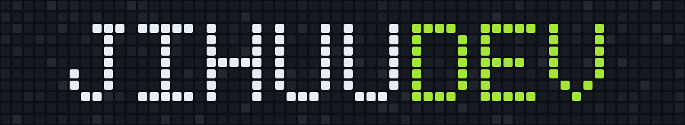

  
  

---

### 👋 About Me

I'm a web developer and part of **Nexus Studio**, where I enjoy turning ideas into clean, functional, and user-friendly applications. I like working across the stack, from crafting interfaces to building the logic behind them, and I'm always exploring new tools and technologies.

### 🛠️ Tech Stack

  

### 📈 GitHub Stats

  
  

  

---

  

